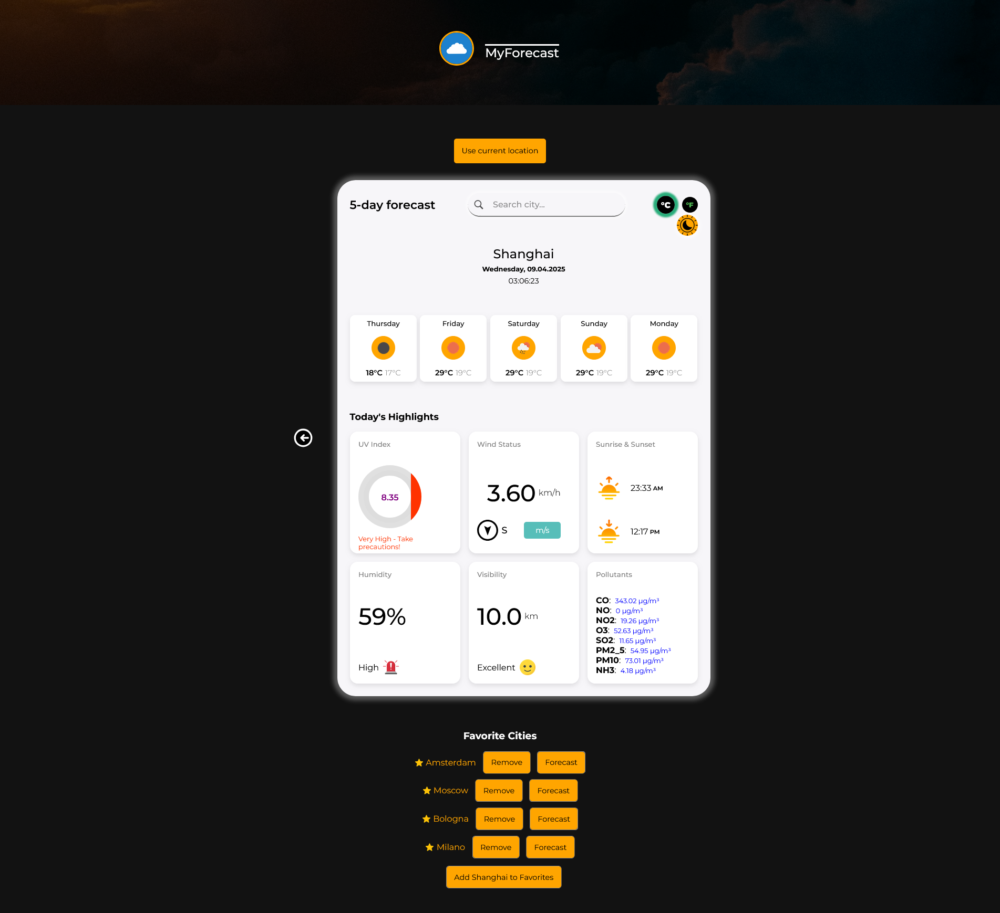
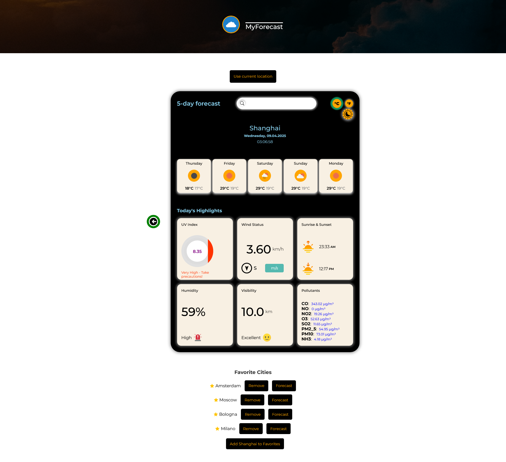
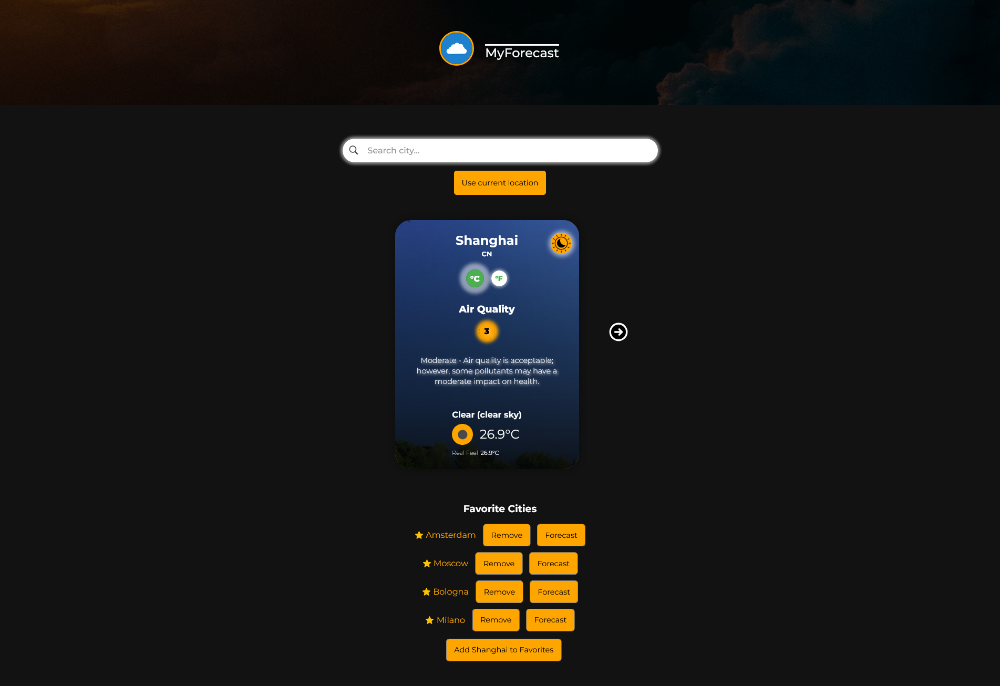
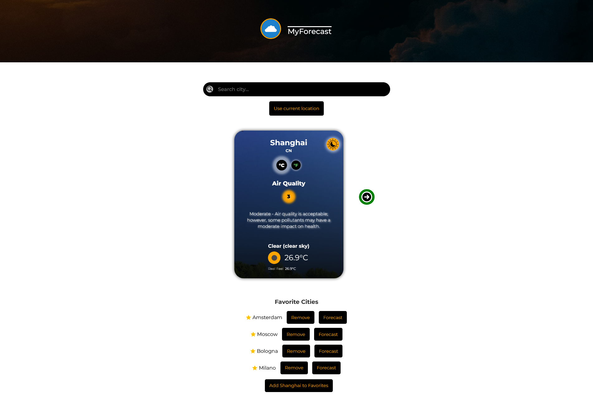
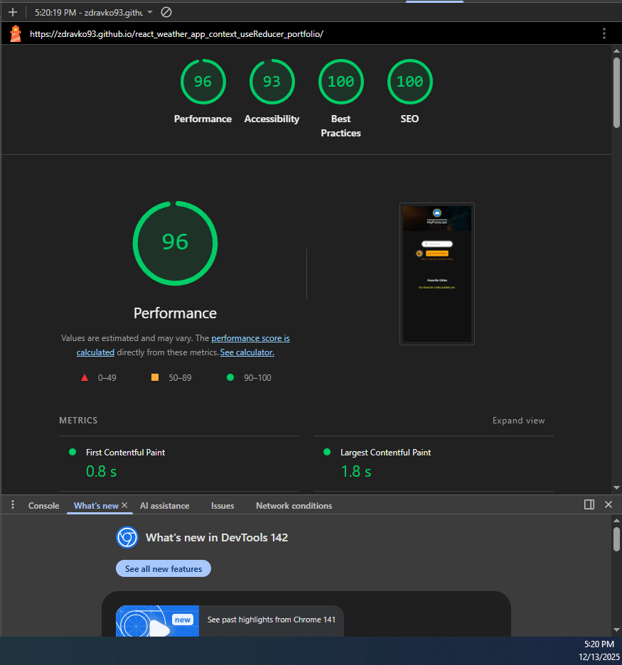
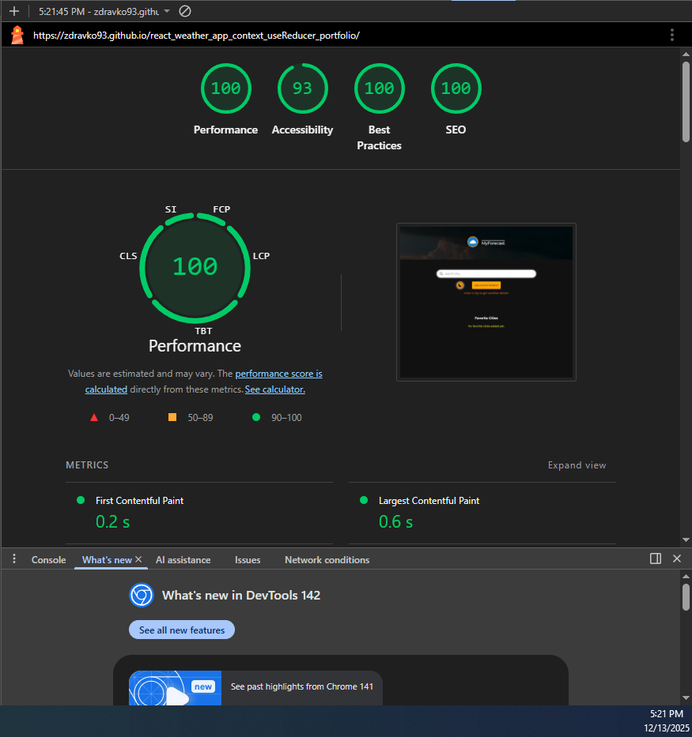

# Weather App - Context API, useReducer

A responsive weather application built with React, allowing users to explore current weather conditions and forecasts for locations worldwide.

The project demonstrates practical experience with React Context API, useReducer, asynchronous API requests, and state management. It also focuses on creating an intuitive user experience with interactive features and customizable settings.

⚠️ **Note**: This repository was rebuilt and re-uploaded following issues with the previous version (cache corruption and deployment bugs). The current version includes a complete refactor with an improved project structure and documentation.


 ## Table of Contents 

- [Overview](#overview)
- [Features](#features)
- [Screenshots](#screenshots)
- [Performance & Accessibility](#performance--accessibility)
- [Live Demo & Source Code](#live-demo--source-code)
- [Technologies Used](#technologies-used)
- [State Management: Context API & useReducer](#state-management-context-api--usereducer)
  - [Why use useReducer](#why-use-usereducer)
- [What I learned](#what-i-learned)
- [Useful Resources](#useful-resources)
- [Installation & Local Setup](#installation--local-setup)
- [Contributing](#contributing)
- [Author](#author)


## Overview 

The goal of this project was to build a feature-rich weather application using the **OpenWeather API**.

Users can search for weather information worldwide, explore detailed forecasts, customize the interface, and save their favorite locations for quick access.

  
## ⚡Features 

---

- Search for current weather conditions in cities worldwide
- Display temperature, air quality, humidity, wind speed, and weather conditions
- View a 5-day weather forecast
- Toggle between dark and light themes
- Switch between Celsius and Fahrenheit
- Navigate between basic and detailed weather views
- Save favorite cities for quick access
- Persist favorite locations using local storage
- Remove saved cities from the favorites list
- Use geolocation to retrieve local weather information and forecasts


## 📸Screenshots

 **Desktop Layout** 






 **Mobile Layout**


## 📊Performance & Accessibility

The application was audited using **Google Lighthouse** in production mode to evaluate its overall quality.

The audit focused on four key areas:

- **Performance**:  Asset loading and application responsiveness
- **Accessibility**: Semantic HTML and appropriate color contrast across themes
- **Best Practices**: Modern React development practices and API integration
- **SEO**: Metadata and document structure

### Lighthouse Reports - Screenshots





## 🌐Live Demo & Source Code

- Solution URL: [Github Repo](https://github.com/Zdravko93/react_weather_app_context_useReducer_portfolio)
- Live Site URL: [Live Demo](https://zdravko93.github.io/react_weather_app_context_useReducer_portfolio/)


## 🛠️Technologies Used

- **HTML5** - Semantic markup
- **CSS3** - Styling, CSS variables, Flexbox, and responsive layouts
- **JavaScript (ES6+)** - Application logic and asynchronous operations
- **React** - Component-based application development
- **Context API** - Global state management and avoiding unnecessary prop drilling
- **useReducer** - Managing complex state transitions
- **OpenWeather API** - Retrieving weather information and forecasts
- **Fetch API** - Handling asynchronous HTTP requests
- **Git & GitHub** - Version control and project management

## 🧩State Management: Context API & useReducer 

This project uses **React Context API** and **useReducer** to organize and manage application state.

### Why use `useReducer`

I chose useReducer for managing state where multiple related values and more complex state transitions were involved.

Its main advantages include:

- **Complex State Logic:** Keeps related state updates organized in one reducer function
- **Predictable State Changes:** Uses dispatched actions to determine how the state changes
- **Maintainability:** Separates state transition logic from component rendering

Combined with Context API, this approach allows shared application state to be accessed across components without excessive prop drilling.


## 📘What I Learned

- Improved responsive design principles
- Strengthened asynchronous JavaScript skills using `fetch()`
- Focused on clean and minimalistic UI/UX
- Implemented error handling for API failures
- Deepened my understanding of React Context API and `useReducer`
- Improved problem-solving and debugging skills
- Gained experience with refactoring and project structure improvements


## 📚Useful Resources

- [React Documentation](https://react.dev/) - Official React documentation
- [MDN Web Docs](https://developer.mozilla.org/en-US/) - Reference for modern web technologies and CSS Flexbox
- [CSS-Tricks](https://css-tricks.com/) - Articles and guides on CSS and custom properties
- [Stack Overflow](https://stackoverflow.com/questions) - Community discussions and solutions to development challenges


## 💻Installation & Local Setup

To run the application locally:

1. Clone the repository:
   ```bash
   git clone https://github.com/Zdravko93/weather_app_context_useReducer_portfolio.git
   ```
2. Navigate to the project directory:
   ```bash
   cd weather_app_context_useReducer_portfolio
   ```
3. Install dependencies

   ```bash
    npm install
   ```

4. Start the development server

   ```bash
   npm start
   ```
   
5. Open your browser at:
 
   http://localhost:3000


## 🤝Contributing

Contributions, suggestions, and bug reports are welcome!

To contribute:

1. Fork the repository
2. Create a new branch (`git checkout -b feature-name`)
3. Make your changes and commit them (`git commit -m 'Add some feature'`)
4. Push to the branch (`git push origin feature-name`)
5. Open a Pull Request explaining your changes

You can also open an issue to report bugs or suggest improvements.


## 📫Author
Created by **Zdravko93**.

- Github - [Zdravko](https://github.com/Zdravko93)
- Frontend Mentor - [@Zdravko93](https://www.frontendmentor.io/profile/Zdravko93)
- LinkedIn - [Zdravko](https://www.linkedin.com/in/zdravkodelic/)
